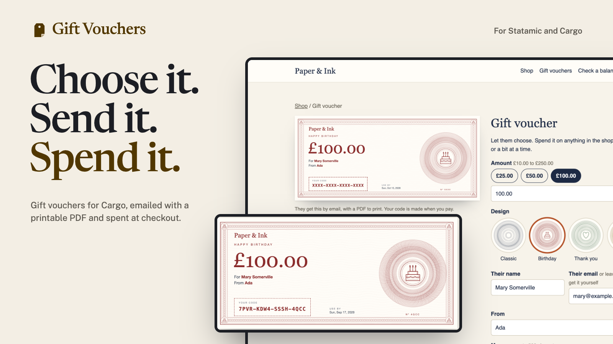
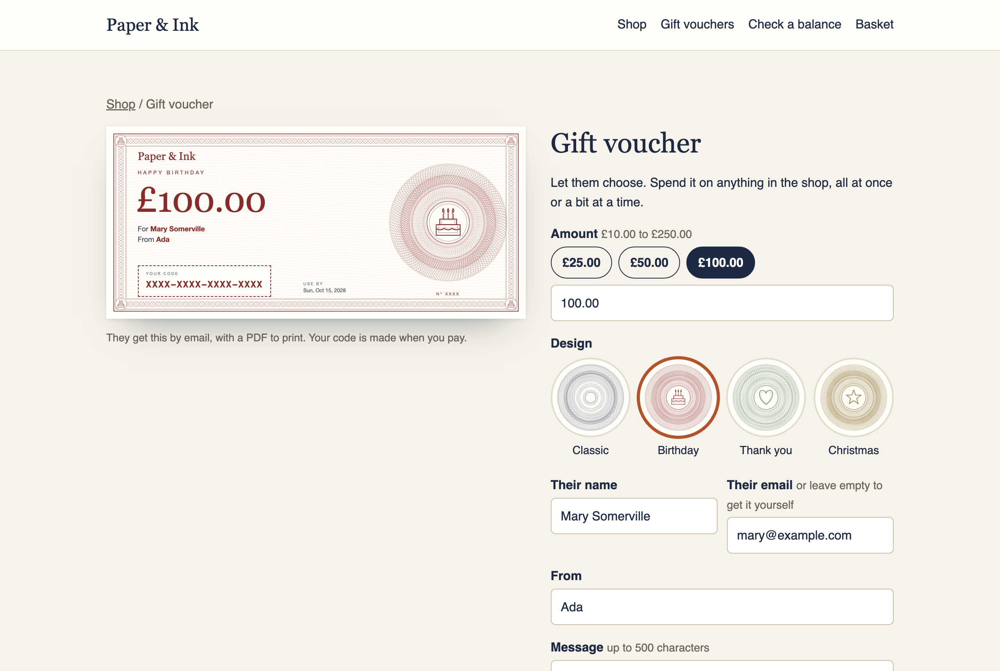

# Gift Vouchers for Statamic

Sell gift vouchers with [Cargo](https://builtwithcargo.dev). Shoppers choose an amount, a design and who it's for. The recipient is emailed an engraved voucher with a printable PDF, and spends it at checkout, all at once or over several orders.



## Features

- **Set or chosen amounts.** Sell a £25 voucher, or let shoppers pick any amount between your limits, with quick choices.
- **Beautiful vouchers.** An engraved, banknote-style pattern in your brand colour, different on every voucher. Or upload your own artwork, or keep it plain.
- **A choice of designs.** Birthday, Christmas, Thank you: each with its own title, colour and engraved motif. Shoppers see a live preview of exactly what they'll send.
- **Emailed, with a PDF.** The recipient gets their code, your message and a printable voucher, straight away or on a date the shopper chooses.
- **Spent at checkout.** Vouchers come off the total after tax, like a payment. Use several on one order; whatever's left stays on the voucher. A fully covered order needs no payment.
- **Safe balances.** A balance can't go below zero, and the same money can't be spent twice, even in two checkouts at once. Every change is recorded.
- **Refunds and cancellations.** Refund the voucher part of an order back onto its vouchers. Cancelled orders get their voucher money back.
- **Control Panel.** Store → Gift Vouchers: balances, history, what's still owed, search, CSV, creating vouchers by hand, changing balances, and permissions.
- **Your templates.** Tags that work without JavaScript, partials for Cargo's prebuilt checkout, and views you can replace with your own Antlers.
- **For developers.** Events, a PHP API and a JSON API.

| The voucher form | The checkout | The Control Panel |
| --- | --- | --- |
|  |  |  |

The screenshots are from Paper & Ink, a made-up shop built only with the tags in [the docs](docs/README.md). **[Try the demo](https://github.com/1994limited/gift-vouchers-statamic-demo)**: it runs locally in a few commands, with no licence needed. See [The demo shop](docs/demo.md).

## Requirements

- Statamic 6.35.1 or later, with Cargo 1.15 or later.
- PHP 8.3 or later, and a database (SQLite is fine).

## Installation

```bash
composer require 1994/gift-vouchers-statamic
php please gift-vouchers:install
```

The installer adds a **Gift voucher** product blueprint, a tax class with no rates, and the database tables. Make a voucher product, then add the form to its template:

```antlers
{{ gift_vouchers:preview }}

{{ gift_vouchers:form redirect="/basket" }}
    <input type="text" name="amount" value="50">
    <input type="text" name="recipient_name" placeholder="Their name">
    <input type="email" name="recipient_email" placeholder="Their email">
    <textarea name="message"></textarea>
    <button>Add to basket</button>
{{ /gift_vouchers:form }}
```

and a box for codes to your basket:

```antlers
{{ gift_vouchers:redeem }}
    <input type="text" name="code" placeholder="Gift voucher code">
    <button>Apply</button>
{{ /gift_vouchers:redeem }}
```

Using Cargo's prebuilt checkout? Add `{{ partial:gift-vouchers::cargo-checkout }}`. See [Cargo's prebuilt checkout](docs/prebuilt-checkout.md).

## Documentation

Everything else is in [the documentation](docs/README.md):

- [Installation](docs/installation.md), [voucher products](docs/products.md) and [designs](docs/designs.md)
- [Templates](docs/templates.md), [tags](docs/tags.md), [Cargo's prebuilt checkout](docs/prebuilt-checkout.md) and [the demo shop](docs/demo.md)
- [Spending vouchers](docs/checkout.md), [orders and refunds](docs/orders-and-refunds.md), [emails](docs/emails.md) and [the Control Panel](docs/control-panel.md)
- [Configuration](docs/configuration.md), [events](docs/events.md), [PHP API](docs/php-api.md), [HTTP API](docs/http-api.md) and [troubleshooting](docs/troubleshooting.md)

## Licence

Gift Vouchers is commercial software, sold through the [Statamic Marketplace](https://statamic.com/marketplace). Try it free on a local or development site. Each public site needs a licence. See [LICENSE.md](LICENSE.md).

## Support

Report bugs and ask questions through the addon's page on the Statamic Marketplace, or email [hello@1994.co.uk](mailto:hello@1994.co.uk).

## Development

```bash
composer install && npm install
vendor/bin/phpunit   # the ledger, checkout with Cargo, refunds, tax, tags, designs, PDFs, emails, the Control Panel
npm run build        # the Control Panel pages
```
