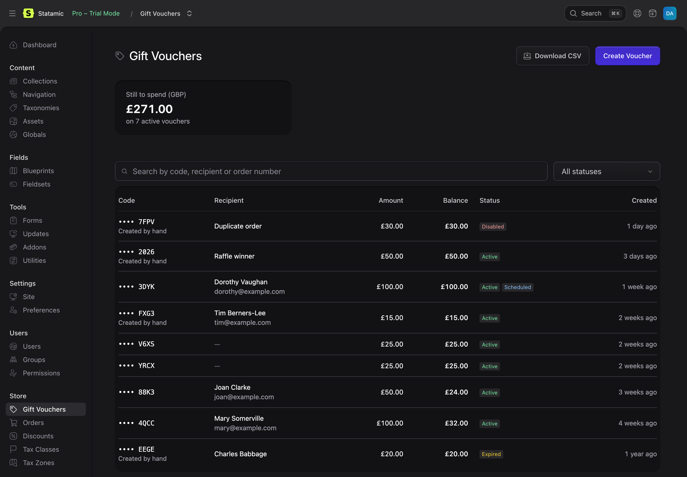
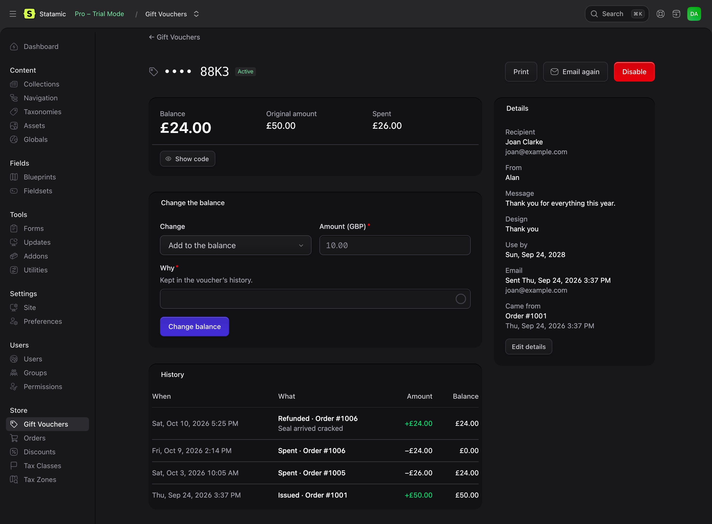
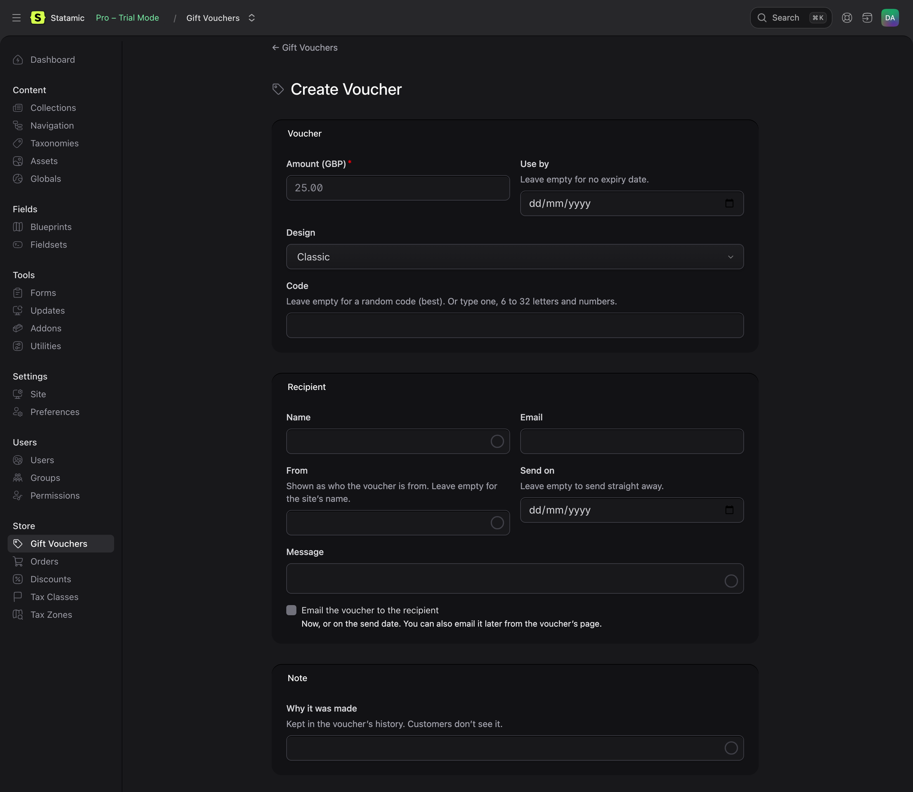

# The Control Panel

## Store → Gift Vouchers

Every voucher, newest first: its code (the last four characters), recipient, amount, balance and status (Active, Spent, Expired or Disabled, and Scheduled while it waits for its send date).

- **Still to spend** shows the total balance of active vouchers in each currency: money your shop owes its customers. Useful for your accounts.
- **Search** by a whole code, its last four characters, a recipient's name or email, or an order number.
- **Filter** by status.
- **Download CSV** downloads the vouchers shown, for a spreadsheet.

## A voucher

- **Balance**, original amount and how much has been spent.
- **Show code** shows the whole code, to read out to a customer who's lost their email.
- **Change the balance** adds to or takes from it, with a note saying why. It can't go below zero.
- **History**: every change, with the order it was spent on or refunded from, who made it, and the balance after.
- **Details**: recipient, message, design, expiry, where it came from, and when it was emailed. **Edit details** changes the recipient, message, expiry and private notes.
- **Print** opens the printable voucher (with a PDF download).
- **Email again** (or **Email now**, for a scheduled voucher).
- **Disable** stops it being spent, without changing its balance. **Enable** undoes it.

## Creating a voucher

**Create Voucher** makes one by hand: for a goodwill gesture, a competition prize, or to replace a lost card.

Choose the amount, expiry, design and recipient. Leave the code empty for a random one (best), or type one, such as `SPRING-FAIR-2026`. The note is kept in the voucher's history. Tick **Email the voucher** to send it now (or on its send date).

## Orders

See [Orders and refunds](orders-and-refunds.md): the Gift Vouchers section on an order, and **Refund to gift voucher**.

## Permissions

Under **Gift Vouchers** in a role's permissions:

| Permission | Allows |
| --- | --- |
| View gift vouchers | The list, each voucher's page and history, and downloading the CSV |
| Create gift vouchers | Creating vouchers by hand |
| Edit gift vouchers, change balances and see codes | Showing codes, changing balances, editing details, disabling, emailing, and printing |

Refunding an order to its vouchers also needs Cargo's *Refund orders*. Super users can do everything.
