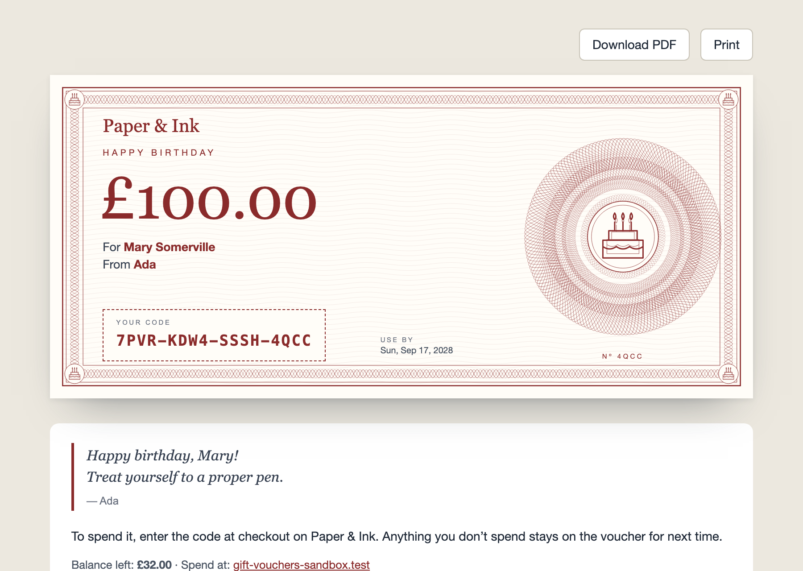

# Designs



Every voucher is a card: on the printable page, in the PDF attached to its email, and as the live preview on your product page. You can change how it looks at three levels:

1. **In the Control Panel**, with no code: the style, colour, logo, wording, and a choice of designs. Most shops need nothing more.
2. **By publishing the views** and editing their HTML and CSS.
3. **With your own templates**, in Antlers or Blade, drawn with the same data.

## The settings

**Tools → Addons → Gift Vouchers → Settings**.

### Voucher

- **Style.** *Engraved* draws fine banknote-style patterns in your brand colour: guilloché rosettes, a border of interlaced waves and corner ornaments. The pattern is worked out from each voucher's ID, so every voucher is a little different, and the same voucher always looks the same. *Plain* is a simple bordered card.
- **Logo.** At the top of the card and the email. Use a PNG or JPEG (up to 2MB); PDFs and many mail apps can't show SVG.
- **Brand colour.** The pattern, the amount, the code's border and the email's button. Text on it turns dark or white, whichever reads better.
- **Title**, **How to spend it** and **Terms.** The wording on the card. Placeholders: `:amount`, `:recipient_name`, `:sender_name`, `:expires` and `:site`.

### Designs

Offer shoppers a choice, such as Birthday, Christmas or Thank you. Each design has:

- **Name.** What shoppers see when choosing.
- **Title on the voucher.** Such as "Happy birthday", in place of the voucher's title.
- **Style.** *Engraved*, *My image* or *Plain*.
- **Motif** (engraved). A heart, star, flower, birthday cake or gift, engraved at the centre of the pattern and in the corners.
- **Image** (my image). Your own artwork fills the card, with the voucher's details on a panel over the left side. Make it 2000 × 920 pixels (or the same shape), PNG or JPEG, up to 5MB, and keep the important part on the right.
- **Colour.** For the pattern, the text and the email. Leave it empty for the brand colour.

The first design is the default. Leave **Designs** empty for one design, from the Voucher tab.

The voucher form shows the designs with `{{ designs }}` (see [Templates](templates.md#a-choice-of-designs)), and each voucher remembers the design it was bought with. Changing a design changes how its existing vouchers look; deleting one shows its vouchers in the first design.

### Email

The subject, heading and introduction of the voucher email. See [Emails](emails.md).

## Publishing the views

```bash
php artisan vendor:publish --tag=gift-vouchers-views
```

This copies the views to `resources/views/vendor/gift-vouchers/`, and the copies are used from then on:

| View | Draws |
| --- | --- |
| `partials/card.blade.php` | The card itself: shared by the printable page, the PDF and the live preview |
| `voucher.blade.php` | The printable page and the PDF: the card, the message, how to spend it, the terms |
| `emails/voucher.blade.php` | The HTML email |
| `emails/voucher-text.blade.php` | The plain-text email |
| `cargo-*.antlers.html` | The partials for [Cargo's prebuilt checkout](prebuilt-checkout.md) |

Things to know when editing:

- **The PDF is drawn by [Dompdf](https://github.com/dompdf/dompdf)**, which reads simple CSS: absolute positions, tables, borders. No flexbox, grid, `aspect-ratio` or web fonts. `$forPdf` is true while it's drawing, so the card uses millimetres and points then. Fonts are DejaVu Sans, Serif and Mono, which come with Dompdf.
- **Nothing is fetched from the web** while a PDF is drawn. Images must be data URIs, as the logo and artwork already are.
- **Escape what shoppers type.** `{{ }}` does in Blade. Names and messages are plain text, kept as typed.
- `$message` is taken in mail views (it's Laravel's message), so the shopper's message is `$giftMessage`.

## Your own templates (Antlers)

Point the views at your own, in `config/gift-vouchers.php`:

```php
'views' => [
    'print' => 'vouchers/print',        // resources/views/vouchers/print.antlers.html
    'pdf' => 'vouchers/print',
    'email' => 'vouchers/email',
    'email_text' => 'vouchers/email-text',
],
```

They get the same variables as the addon's views:

| Variable | Is |
| --- | --- |
| `title`, `amount`, `balance`, `code`, `expires` | As shown on the card (`expires` is empty if it never does) |
| `recipientName`, `senderName`, `giftMessage` | As the shopper typed them. **Antlers doesn't escape**: use `\| sanitize` |
| `howTo`, `terms`, `heading`, `intro` | The settings' wording, placeholders filled in |
| `artwork`, `artworkKind` | The design's card background as a data URI, and `engraved`, `image` or empty |
| `colour`, `onColour` | The design's colour, and the text colour that reads on it |
| `logo`, `logoAlt`, `siteName`, `siteUrl` | |
| `printUrl`, `pdfUrl` | The signed links to this voucher |
| `forPdf`, `forEmail` | Which you're drawing |
| `voucher` | The voucher itself (see the [PHP API](php-api.md)) |

## The pattern on your own pages

`{{ gift_vouchers:artwork design="birthday" }}` draws a design's engraved card as inline SVG, and `shape="emblem"` draws just the rosette. Use them for banners or a "Gift vouchers" page.

## Your own pattern (PHP)

The engraving is drawn by `NineteenNinetyFour\GiftVouchers\Artwork`, made through Laravel's container with `seed`, `colour` and `motif`. Bind your own subclass to change it:

```php
$this->app->bind(\NineteenNinetyFour\GiftVouchers\Artwork::class, \App\VoucherArtwork::class);
```
