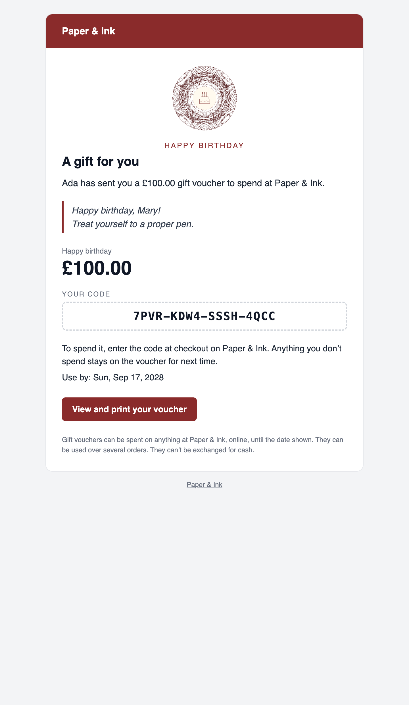

# Emails

When a voucher is made, it's emailed to its recipient (or the customer, if no recipient was given). The email has the amount, the code, the shopper's message, how to spend it, a link to the printable voucher, and the voucher attached as a PDF.



## The wording

**Tools → Addons → Gift Vouchers → Settings → Email**: the subject, heading and introduction, with placeholders `:amount`, `:recipient_name`, `:sender_name`, `:expires` and `:site`. A design's title shows above the heading, and, with PHP's Imagick extension, the design's emblem too.

To change more, [publish the views](designs.md#publishing-the-views) or [use your own](designs.md#your-own-templates-antlers).

Emails are sent from your site's `MAIL_FROM_ADDRESS`, with Laravel's mail settings.

## Send dates

A shopper can choose a day to send the voucher, from tomorrow up to a year ahead: for a birthday, say. The voucher is made when the order's paid (so its code works from then), and emailed on the day by:

```bash
php please gift-vouchers:send
```

which runs every fifteen minutes with Laravel's scheduler. Make sure the scheduler is running on your server:

```
* * * * * cd /path/to/site && php artisan schedule:run >> /dev/null 2>&1
```

To run it your own way, set `schedule` to `false` and run the command yourself.

The Control Panel shows scheduled vouchers with a **Scheduled** badge, and **Email now** sends one early.

## Sending again

**Email again** on a voucher's page sends it to its recipient (or the customer). Change the recipient first under **Edit details** if they've given you a new address.

## Options

In `config/gift-vouchers.php`:

```php
'email' => [
    'enabled' => true,       // false: make vouchers, but don't email them
    'attach_pdf' => true,    // attach the voucher as a PDF
    'bcc' => null,           // copy every voucher email to this address
    'queue' => null,         // a queue name to send them on, or null to send straight away
],
```

## Testing emails locally

Use a local mail catcher, such as Herd's HELO, Mailpit or Mailtrap. For HELO, in `.env`:

```env
MAIL_MAILER=smtp
MAIL_HOST=127.0.0.1
MAIL_PORT=2525
MAIL_USERNAME=My-Shop
MAIL_PASSWORD=null
MAIL_ENCRYPTION=null
```

Then check out with a voucher in the basket, or press **Email now** on a voucher's page.
