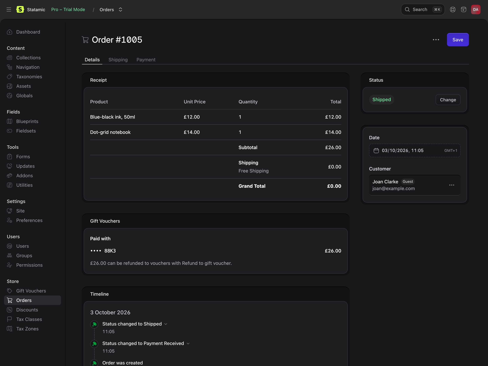

# Orders and refunds

Gift Vouchers follows Cargo's orders through their statuses. Everything it does is written on the order's timeline and in the vouchers' history.

## When vouchers are made

Vouchers bought on an order are made when the order is **paid** (Cargo's Payment Received status): straight away for free orders and most gateways, or when the payment is captured.

- One voucher per voucher bought: a quantity of 3 makes three, each with its own code.
- Each is worth what was paid for it, in the order's currency, and expires after the product's months (if any).
- It's emailed to its recipient, or the customer if no recipient was given, on its send date or straight away. See [Emails](emails.md).

Marking an order paid again (an admin moving it back and forth) makes no more vouchers. A database index makes sure of it, even if two requests arrive together.

If a voucher email can't be sent (the mail server's down), the order still goes through: the problem is logged, and you can send it again from the voucher's page.

## When an order fails or is cancelled

- **Payment fails at checkout.** Cargo deletes the order it started; anything spent from vouchers on it is put back.
- **The order is cancelled** (its status changed to Cancelled). What it spent from vouchers is put back, and the vouchers bought on it are disabled, so they can't be spent. Turn this off with `restore_on_cancel`.
- **A paid order is deleted.** Nothing is put back: deleting isn't refunding. Refund the order first.

Moving a cancelled order back to Paid doesn't spend the vouchers again, or enable the vouchers it bought: do that by hand if you need to.

## Refunds

An order can be paid partly by voucher and partly by card. Each part is refunded its own way:

- **The card part**, with Cargo's **Refund** action, as normal.
- **The voucher part**, with **Refund to gift voucher** (in the order's actions menu). It puts the amount back on the vouchers used, the most recently spent first, up to what they paid. Orders paid entirely by voucher have no gateway, so this is the only way to refund them.

Refund to gift voucher needs Cargo's *Refund orders* permission and *Edit gift vouchers*.

### Refunding an order that bought vouchers

If an order is refunded in full with Cargo's Refund, the vouchers it bought are disabled (`disable_on_full_refund`). After a part refund, they're left alone and a note on the order's timeline reminds you to check them: you might have refunded a voucher, or something else on the order. Lower or disable vouchers by hand on their pages.

Refunds made in your payment provider's dashboard (not through Cargo) don't tell Gift Vouchers anything. Adjust the vouchers by hand.

## On the order

The order's **Details** tab shows a **Gift Vouchers** section under the receipt: the vouchers it was paid with (and anything put back), what can still be refunded to them, and the vouchers bought on it with their balances. Cargo's receipt can't list vouchers itself, so its grand total is the amount after them.

The voucher's recipient, message and send date are shown with its line item on the receipt and on packing slips.

