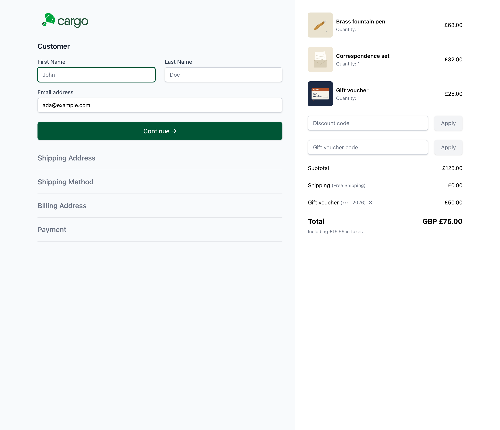

# Cargo's prebuilt checkout



> These partials are Antlers, as Cargo's prebuilt checkout is. A Blade site with its own checkout uses the tags instead: see [Templates](templates.md), where every example has a Blade version.

Cargo comes with a ready-made checkout (published to `resources/views/checkout/` by `php please cargo:install`). Gift Vouchers has partials that fit it: a box for codes, the vouchers as lines with the totals, and the order confirmation. They use the checkout's own Alpine.js, styles and wording.

## The checkout

In `resources/views/checkout/components/_cart_summary.antlers.html`, add the box for codes after the discount code form:

```antlers
{{ partial:gift-vouchers::cargo-checkout }}
```

and the vouchers with the totals, before the Taxes and Total rows:

```antlers
{{ partial:gift-vouchers::cargo-checkout-lines }}
```

When a code is used or a voucher taken off, the checkout's totals update without a reload, and the payment step follows the new total. If the vouchers cover everything, Cargo's "No payment required" step shows instead of the payment form. When the shopper picks a shipping option, the vouchers follow the new total too.

## The confirmation page

In `resources/views/checkout/components/_order_summary.antlers.html`, after the discounts:

```antlers
{{ partial:gift-vouchers::cargo-order-summary :order="id" }}
```

and in `resources/views/checkout/confirmation.antlers.html`, the vouchers bought (inside `{{ orders }}`):

```antlers
{{ if {gift_vouchers:issued :order="id"} }}
    <div class="bg-white p-6 border border-gray-200 rounded-lg mb-6">
        {{ partial:gift-vouchers::cargo-confirmation :order="id" }}
    </div>
{{ /if }}
```

## Voucher products in the summary

Cargo's line items show the voucher's recipient and message in the Control Panel and on packing slips by themselves. To show them in the checkout summary too, add to the line item in `_cart_summary.antlers.html`:

```antlers
{{ if voucher_recipient_name }}
    <span class="text-xs text-gray-500">{{ 'For' | trans }} {{ voucher_recipient_name | sanitize }}</span>
{{ /if }}
```

## Changing the partials

They're in the addon's views; [publish them](designs.md#publishing-the-views) to edit them. They have no `<script>` of their own (Cargo draws the summary inside Alpine `<template>`s, where scripts don't run), so their Alpine code is in their `x-data`.
